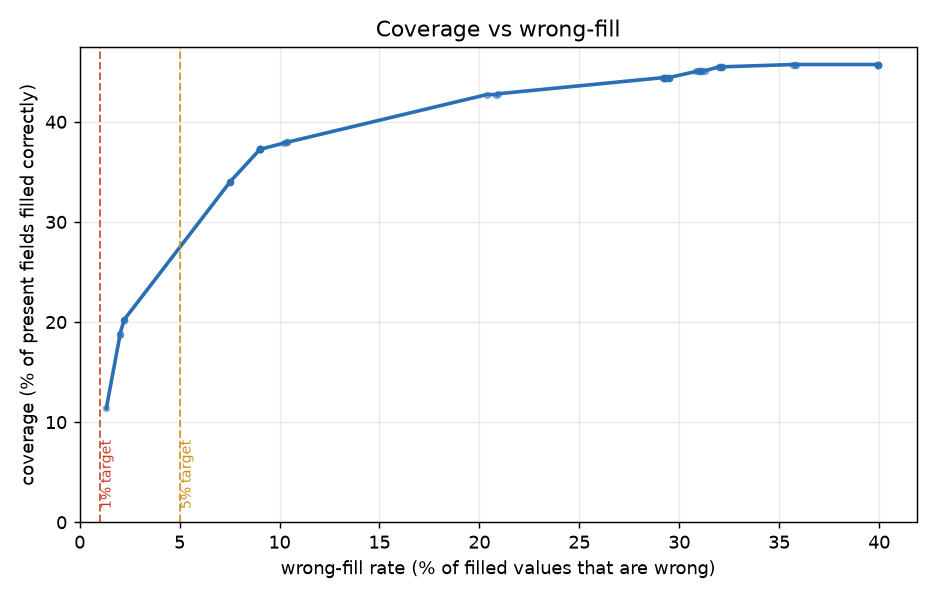

# Fact-find extraction - final report

Generated 2026-11-16 from the **test** split (54 pages), scored once.

> **These numbers are from generated pages, not real client notes.**
> They show the pipeline works end to end and give a reference point, but they are not evidence about your documents. Synthetic pages are cleaner and more regular than a photographed handwritten note, so treat every number here as an optimistic upper bound. The brief's targets can only be claimed against real data.

## Headline

| | baseline (rules) | final | target |
| --- | ---: | ---: | ---: |
| wrong-fill rate | 42.83% | **8.02%** | see per-kind |
| exact match | 42.6% | **22.9%** | maximise |
| coverage | 60.7% | **24.8%** | maximise |
| unsure | 2.2% | **51.2%** | - |
| missing | 38.6% | **37.0%** | - |
| values filled | 969 | **324** | - |
| wrong values filled | 415 | **26** | - |

`wrong-fill rate` is the share of everything the pipeline chose to fill that was wrong, including values it filled for fields the page never mentioned. `coverage` is the share of the fields actually present on the pages that were filled correctly.

Of the values the pipeline left unsure, **48.1%** had the correct answer inside the top 3 candidates it offered.

## Targets

**Targets missed.** They have not been lowered.

| kind | wrong-fill | target | met | filled | wrong | coverage |
| --- | ---: | ---: | :---: | ---: | ---: | ---: |
| choice | 1.96% | 1.00% | **no** | 102 | 2 | 45.1% |
| date | 0.00% | 1.00% | yes | 18 | 0 | 15.4% |
| email | 0.00% | 0.00% | yes | 0 | 0 | 0.0% |
| fullName | 35.71% | 5.00% | **no** | 14 | 5 | 40.6% |
| money | 0.00% | 1.00% | yes | 7 | 0 | 2.9% |
| name | 28.30% | 5.00% | **no** | 53 | 15 | 40.0% |
| niNumber | 0.00% | 0.00% | yes | 0 | 0 | 0.0% |
| number | 0.00% | 1.00% | yes | 24 | 0 | 31.2% |
| phone | 0.00% | 0.00% | yes | 15 | 0 | 26.8% |
| text | 30.00% | 5.00% | **no** | 10 | 3 | 6.9% |
| yesNo | 1.23% | 1.00% | **no** | 81 | 1 | 38.9% |

## Validation against test

Thresholds were chosen on validation. Where test is worse, the threshold was fitted to the validation writers and did not carry over - which is the single most important number in this report, because it is what would happen on a new adviser's handwriting.

| kind | validation wrong-fill | test wrong-fill | moved by |
| --- | ---: | ---: | ---: |
| fullName | 0.00% | 35.71% | +35.71% |
| text | 0.00% | 30.00% | +30.00% |
| name | 4.48% | 28.30% | +23.82% |
| choice | 0.70% | 1.96% | +1.26% |
| yesNo | 0.93% | 1.23% | +0.31% |
| date | 0.00% | 0.00% | 0.00% |
| money | 0.00% | 0.00% | 0.00% |
| number | 0.00% | 0.00% | 0.00% |
| phone | 0.00% | 0.00% | 0.00% |

5 of 9 kinds got worse on test.

The cause is sample size, not a modelling flaw: the thresholds were fitted on the validation split's writers only. With a handful of writers, a threshold that looks safe on validation is partly fitted to those particular hands. The fix is more writers, not a different model - and until then the validation numbers should be read as optimistic.

### What would close each gap

**choice** - 1.96% against a 1.00% target (2 wrong of 102 filled).

  - raising this kind's threshold trades coverage for correctness; the curve above shows exactly how much.
  - add the wordings advisers actually use to this field's aliases in the knowledge file - no retraining needed.
  - a printed template form with boxed fields would remove most of this error class outright, if the business can adopt one.

**fullName** - 35.71% against a 5.00% target (5 wrong of 14 filled).

  - only 14 values of this kind were filled on this split. A 5.00% rate cannot be demonstrated at that size - roughly 60 filled examples are needed before the measurement means anything.
  - raising this kind's threshold trades coverage for correctness; the curve above shows exactly how much.
  - the limit here is handwriting recognition, not field matching. The biggest single win is a value recogniser fine-tuned on your own cropped value regions - which needs a few thousand labelled crops from real notes.
  - a printed template form with boxed fields would remove most of this error class outright, if the business can adopt one.

**name** - 28.30% against a 5.00% target (15 wrong of 53 filled).

  - only 53 values of this kind were filled on this split. A 5.00% rate cannot be demonstrated at that size - roughly 60 filled examples are needed before the measurement means anything.
  - raising this kind's threshold trades coverage for correctness; the curve above shows exactly how much.
  - the limit here is handwriting recognition, not field matching. The biggest single win is a value recogniser fine-tuned on your own cropped value regions - which needs a few thousand labelled crops from real notes.
  - a printed template form with boxed fields would remove most of this error class outright, if the business can adopt one.

**text** - 30.00% against a 5.00% target (3 wrong of 10 filled).

  - only 10 values of this kind were filled on this split. A 5.00% rate cannot be demonstrated at that size - roughly 60 filled examples are needed before the measurement means anything.
  - raising this kind's threshold trades coverage for correctness; the curve above shows exactly how much.
  - the limit here is handwriting recognition, not field matching. The biggest single win is a value recogniser fine-tuned on your own cropped value regions - which needs a few thousand labelled crops from real notes.
  - a printed template form with boxed fields would remove most of this error class outright, if the business can adopt one.

**yesNo** - 1.23% against a 1.00% target (1 wrong of 81 filled).

  - only 81 values of this kind were filled on this split. A 1.00% rate cannot be demonstrated at that size - roughly 300 filled examples are needed before the measurement means anything.
  - raising this kind's threshold trades coverage for correctness; the curve above shows exactly how much.
  - add the wordings advisers actually use to this field's aliases in the knowledge file - no retraining needed.
  - a printed template form with boxed fields would remove most of this error class outright, if the business can adopt one.

## Coverage vs wrong-fill

Each point is a fill threshold. Moving left refuses more values (lower wrong-fill, lower coverage); moving right fills more. The shipped thresholds are chosen per kind as the leftmost point that still meets that kind's target.

## Per field

Fields with at least one example on this split, worst wrong-fill first.

| field | kind | n | baseline exact | final exact | baseline wrong | final wrong | unsure | missing | target met |
| --- | --- | ---: | ---: | ---: | ---: | ---: | ---: | ---: | :---: |
| `personal-details.passportNo` | text | 14 | 50.0% | 0.0% | 63.16% | 100.00% | 100.0% | 28.6% | **no** |
| `company-details.primaryFirstName` | text | 9 | 11.1% | 0.0% | 91.67% | 100.00% | 122.2% | 22.2% | **no** |
| `dependants.name` | name | 26 | 19.2% | 7.7% | 89.80% | 66.67% | 107.7% | 26.9% | **no** |
| `dependants.relationshipType` | choice | 26 | 34.6% | 3.8% | 10.00% | 50.00% | 46.2% | 46.2% | **no** |
| `company-details.primaryLastName` | text | 12 | 16.7% | 8.3% | 80.00% | 50.00% | 75.0% | 33.3% | **no** |
| `personal-details.fullName` | fullName | 32 | 28.1% | 28.1% | 80.00% | 35.71% | 68.8% | 15.6% | **no** |
| `personal-details.lastName` | name | 34 | 35.3% | 32.4% | 62.50% | 35.29% | 44.1% | 20.6% | **no** |
| `personal-details.firstName` | name | 35 | 42.9% | 40.0% | 57.14% | 17.65% | 57.1% | 17.1% | **no** |
| `personal-details.middleName` | name | 35 | 42.9% | 31.4% | 51.61% | 15.38% | 51.4% | 28.6% | **no** |
| `personal-details.isGoodHealth` | yesNo | 27 | 66.7% | 59.3% | 5.26% | 5.88% | 7.4% | 29.6% | **no** |
| `personal-details.maritalStatus` | choice | 37 | 59.5% | 56.8% | 4.35% | 4.55% | 10.8% | 32.4% | **no** |
| `personal-details.email` | email | 45 | 24.4% | 0.0% | 60.71% | 0.00% | 55.6% | 44.4% | yes |
| `personal-details.isSmoker` | yesNo | 40 | 60.0% | 60.0% | 4.00% | 0.00% | 7.5% | 32.5% | yes |
| `personal-details.gender` | choice | 37 | 64.9% | 67.6% | 0.00% | 0.00% | 2.7% | 29.7% | yes |
| `personal-details.countryOfBirth` | choice | 35 | 57.1% | 51.4% | 31.03% | 0.00% | 28.6% | 22.9% | yes |
| `personal-details.dateOfBirth` | date | 35 | 34.3% | 14.3% | 0.00% | 0.00% | 25.7% | 60.0% | yes |
| `personal-details.mobileNumber` | phone | 35 | 74.3% | 42.9% | 3.70% | 0.00% | 22.9% | 34.3% | yes |
| `personal-details.retirementAge` | number | 35 | 65.7% | 57.1% | 4.17% | 0.00% | 17.1% | 28.6% | yes |
| `personal-details.nationality` | choice | 34 | 50.0% | 50.0% | 29.17% | 0.00% | 29.4% | 23.5% | yes |
| `personal-details.hasWill` | yesNo | 33 | 39.4% | 51.5% | 7.14% | 0.00% | 9.1% | 39.4% | yes |
| `personal-details.title` | choice | 30 | 40.0% | 43.3% | 0.00% | 0.00% | 3.3% | 53.3% | yes |
| `dependants.dateOfBirth` | date | 26 | 23.1% | 0.0% | 0.00% | 0.00% | 42.3% | 57.7% | yes |
| `dependants.isForWholeOfLife` | yesNo | 25 | 20.0% | 8.0% | 0.00% | 0.00% | 24.0% | 68.0% | yes |
| `personal-details.drivingLicenceNumber` | text | 16 | 6.2% | 0.0% | 96.55% | 0.00% | 150.0% | 12.5% | yes |
| `company-details.primaryJobTitle` | text | 14 | 21.4% | 0.0% | 62.50% | 0.00% | 50.0% | 57.1% | yes |
| `personal-details.drivingLicenceExpiryDate` | date | 14 | 35.7% | 35.7% | 0.00% | 0.00% | 21.4% | 42.9% | yes |
| `company-details.primaryEmail` | email | 13 | 23.1% | 0.0% | 40.00% | 0.00% | 46.2% | 53.8% | yes |
| `employment.startDate` | date | 13 | 38.5% | 0.0% | 0.00% | 0.00% | 38.5% | 61.5% | yes |
| `company-details.numberOfEmployees` | number | 12 | 25.0% | 8.3% | 62.50% | 0.00% | 66.7% | 33.3% | yes |
| `company-details.telephoneNumber` | phone | 12 | 41.7% | 0.0% | 0.00% | 0.00% | 66.7% | 33.3% | yes |
| `personal-details.niNumber` | niNumber | 12 | 25.0% | 0.0% | 40.00% | 0.00% | 50.0% | 50.0% | yes |
| `personal-details.passportValidTo` | date | 12 | 33.3% | 33.3% | 0.00% | 0.00% | 16.7% | 50.0% | yes |
| `company-details.businessTurnover` | money | 11 | 54.5% | 0.0% | 14.29% | 0.00% | 72.7% | 36.4% | yes |
| `company-details.natureOfBusiness` | text | 11 | 36.4% | 0.0% | 60.00% | 0.00% | 81.8% | 27.3% | yes |
| `company-details.registeredNumberAndAddress` | text | 11 | 36.4% | 0.0% | 71.43% | 0.00% | 100.0% | 36.4% | yes |
| `employment.employerName` | text | 11 | 9.1% | 0.0% | 92.31% | 0.00% | 72.7% | 81.8% | yes |
| `employment.occupation` | text | 11 | 54.5% | 45.5% | 45.45% | 0.00% | 63.6% | 0.0% | yes |
| `health.hadMedicalAppointmentsLast12Months` | yesNo | 11 | 45.5% | 27.3% | 0.00% | 0.00% | 45.5% | 27.3% | yes |
| `health.hasPlannedOrPendingAppointments` | yesNo | 11 | 54.5% | 36.4% | 0.00% | 0.00% | 27.3% | 36.4% | yes |
| `health.tookEarlyRetirementIllHealth` | yesNo | 11 | 54.5% | 9.1% | 0.00% | 0.00% | 54.5% | 36.4% | yes |
| `income-expenditure.totalIncome` | money | 11 | 63.6% | 0.0% | 12.50% | 0.00% | 72.7% | 36.4% | yes |
| `life-style.isPregnant` | yesNo | 11 | 63.6% | 45.5% | 0.00% | 0.00% | 27.3% | 27.3% | yes |
| `personal-details.holdsDrivingLicence` | yesNo | 11 | 45.5% | 36.4% | 0.00% | 0.00% | 9.1% | 54.5% | yes |
| `company-details.grossProfit` | money | 10 | 50.0% | 10.0% | 28.57% | 0.00% | 40.0% | 60.0% | yes |
| `dependants.dependencyTermYears` | number | 10 | 30.0% | 0.0% | 66.67% | 0.00% | 110.0% | 50.0% | yes |
| `employment.employmentBasis` | choice | 10 | 60.0% | 30.0% | 0.00% | 0.00% | 30.0% | 40.0% | yes |
| `income-expenditure.disposableIncome` | money | 10 | 60.0% | 0.0% | 0.00% | 0.00% | 70.0% | 30.0% | yes |
| `income-expenditure.totalExpenditure` | money | 10 | 30.0% | 0.0% | 25.00% | 0.00% | 40.0% | 60.0% | yes |
| `assets.businessAssets` | money | 9 | 55.6% | 0.0% | 0.00% | 0.00% | 66.7% | 44.4% | yes |
| `assets.investmentBonds` | money | 9 | 33.3% | 0.0% | 0.00% | 0.00% | 44.4% | 66.7% | yes |
| `company-details.netProfit` | money | 9 | 33.3% | 0.0% | 50.00% | 0.00% | 111.1% | 33.3% | yes |
| `company-details.primaryPhone` | phone | 9 | 44.4% | 0.0% | 0.00% | 0.00% | 55.6% | 44.4% | yes |
| `personal-details.drivingLicenceIssueDate` | date | 9 | 33.3% | 33.3% | 50.00% | 0.00% | 22.2% | 44.4% | yes |
| `company-details.companyName` | text | 8 | 37.5% | 12.5% | 75.00% | 0.00% | 100.0% | 25.0% | yes |
| `company-details.totalValueOfBusiness` | money | 8 | 25.0% | 0.0% | 50.00% | 0.00% | 50.0% | 62.5% | yes |
| `employment.grossAnnualSalary` | money | 8 | 75.0% | 0.0% | 50.00% | 0.00% | 125.0% | 25.0% | yes |
| `employment.overtimeAmount` | money | 8 | 50.0% | 0.0% | 0.00% | 0.00% | 50.0% | 50.0% | yes |
| `employment.overtimeFrequency` | choice | 8 | 37.5% | 25.0% | 0.00% | 0.00% | 50.0% | 25.0% | yes |
| `life-style.alcoholUnitsPerWeek` | number | 8 | 62.5% | 12.5% | 16.67% | 0.00% | 50.0% | 37.5% | yes |
| `personal-details.passportValidFrom` | date | 8 | 50.0% | 12.5% | 0.00% | 0.00% | 62.5% | 25.0% | yes |
| `assets.pensionFunds` | money | 7 | 42.9% | 0.0% | 25.00% | 0.00% | 71.4% | 28.6% | yes |
| `employment.commissionAmount` | money | 7 | 85.7% | 0.0% | 0.00% | 0.00% | 71.4% | 28.6% | yes |
| `employment.commissionFrequency` | choice | 7 | 71.4% | 0.0% | 16.67% | 0.00% | 85.7% | 14.3% | yes |
| `employment.jobTitle` | text | 7 | 14.3% | 0.0% | 87.50% | 0.00% | 114.3% | 42.9% | yes |
| `expenditure.councilTax` | money | 7 | 71.4% | 14.3% | 0.00% | 0.00% | 57.1% | 28.6% | yes |
| `health.hasNoFamilyHistoryConditions` | yesNo | 7 | 28.6% | 0.0% | 0.00% | 0.00% | 28.6% | 71.4% | yes |
| `income-expenditure.savingsAndInvestments` | money | 7 | 14.3% | 0.0% | 75.00% | 0.00% | 57.1% | 57.1% | yes |
| `life-style.doesSmoke` | yesNo | 7 | 57.1% | 42.9% | 0.00% | 0.00% | 28.6% | 42.9% | yes |
| `assets.allOtherAssets` | money | 6 | 16.7% | 0.0% | 50.00% | 0.00% | 83.3% | 33.3% | yes |
| `assets.cashDeposits` | money | 6 | 33.3% | 0.0% | 0.00% | 0.00% | 33.3% | 66.7% | yes |
| `assets.isa` | money | 6 | 33.3% | 0.0% | 60.00% | 0.00% | 83.3% | 33.3% | yes |
| `assets.property` | money | 6 | 50.0% | 0.0% | 25.00% | 0.00% | 50.0% | 50.0% | yes |
| `expenditure.otherMortgageOrRent` | money | 6 | 66.7% | 0.0% | 33.33% | 0.00% | 116.7% | 0.0% | yes |
| `expenditure.studentLoan` | money | 6 | 50.0% | 16.7% | 0.00% | 0.00% | 33.3% | 50.0% | yes |
| `life-style.doesHazardousSports` | yesNo | 6 | 33.3% | 16.7% | 0.00% | 0.00% | 16.7% | 66.7% | yes |
| `expenditure.householdMaintenance` | money | 5 | 40.0% | 0.0% | 50.00% | 0.00% | 60.0% | 40.0% | yes |
| `expenditure.miscellaneous` | money | 5 | 60.0% | 0.0% | 40.00% | 0.00% | 100.0% | 20.0% | yes |
| `expenditure.pensionContributions` | money | 5 | 40.0% | 0.0% | 0.00% | 0.00% | 40.0% | 60.0% | yes |
| `expenditure.utilityBills` | money | 5 | 20.0% | 20.0% | 75.00% | 0.00% | 40.0% | 40.0% | yes |
| `expenditure.water` | money | 5 | 100.0% | 0.0% | 0.00% | 0.00% | 100.0% | 20.0% | yes |
| `health.earlyRetirementDetails` | text | 5 | 0.0% | 0.0% | 100.00% | 0.00% | 340.0% | 0.0% | yes |
| `health.hasNoDiagnosedConditions` | yesNo | 5 | 40.0% | 0.0% | 33.33% | 0.00% | 80.0% | 40.0% | yes |
| `assets.shares` | money | 4 | 25.0% | 0.0% | 0.00% | 0.00% | 0.0% | 100.0% | yes |
| `expenditure.additionalInformation` | text | 4 | 0.0% | 0.0% | 100.00% | 0.00% | 375.0% | 0.0% | yes |
| `expenditure.communications` | money | 4 | 50.0% | 0.0% | 0.00% | 0.00% | 75.0% | 25.0% | yes |
| `expenditure.educationFees` | money | 4 | 50.0% | 25.0% | 0.00% | 0.00% | 25.0% | 50.0% | yes |
| `expenditure.entertainment` | money | 4 | 50.0% | 0.0% | 33.33% | 0.00% | 100.0% | 25.0% | yes |
| `expenditure.insurances` | money | 4 | 75.0% | 25.0% | 40.00% | 0.00% | 100.0% | 0.0% | yes |
| `expenditure.investments` | money | 4 | 50.0% | 0.0% | 0.00% | 0.00% | 75.0% | 25.0% | yes |
| `health.plannedAppointmentsDetails` | text | 4 | 0.0% | 0.0% | 100.00% | 0.00% | 125.0% | 0.0% | yes |
| `life-style.heightBeforePregnancy` | text | 4 | 0.0% | 0.0% | 100.00% | 0.00% | 25.0% | 75.0% | yes |
| `life-style.lastSmokedMonths` | number | 4 | 50.0% | 25.0% | 0.00% | 0.00% | 50.0% | 25.0% | yes |
| `life-style.lastSmokedYears` | number | 4 | 50.0% | 25.0% | 66.67% | 0.00% | 175.0% | 25.0% | yes |
| `life-style.weightBeforePregnancyKg` | number | 4 | 25.0% | 0.0% | 0.00% | 0.00% | 25.0% | 75.0% | yes |
| `credit.mortgageOtherProperty` | money | 3 | 33.3% | 0.0% | 0.00% | 0.00% | 33.3% | 66.7% | yes |
| `expenditure.anticipatesIncreaseNextFiveYears` | yesNo | 3 | 66.7% | 0.0% | 0.00% | 0.00% | 66.7% | 33.3% | yes |
| `expenditure.foodAndClothing` | money | 3 | 33.3% | 0.0% | 0.00% | 0.00% | 66.7% | 66.7% | yes |
| `expenditure.holidays` | money | 3 | 66.7% | 33.3% | 0.00% | 0.00% | 33.3% | 33.3% | yes |
| `expenditure.transportCosts` | money | 3 | 33.3% | 0.0% | 0.00% | 0.00% | 66.7% | 33.3% | yes |
| `health.medicalAppointmentsDetails` | text | 3 | 0.0% | 0.0% | 100.00% | 0.00% | 533.3% | 0.0% | yes |
| `credit.anyOtherLending` | money | 2 | 0.0% | 0.0% | 100.00% | 0.00% | 50.0% | 50.0% | yes |
| `credit.creditCards` | money | 2 | 50.0% | 0.0% | 0.00% | 0.00% | 50.0% | 50.0% | yes |
| `credit.mortgageMainResidence` | money | 2 | 100.0% | 0.0% | 0.00% | 0.00% | 150.0% | 0.0% | yes |
| `credit.overdraft` | money | 2 | 0.0% | 0.0% | 100.00% | 0.00% | 50.0% | 50.0% | yes |
| `employment.bonusAmount` | money | 2 | 100.0% | 0.0% | 50.00% | 0.00% | 250.0% | 0.0% | yes |
| `employment.bonusFrequency` | choice | 2 | 50.0% | 0.0% | 50.00% | 0.00% | 100.0% | 0.0% | yes |
| `credit.loansHp` | money | 1 | 0.0% | 0.0% | 100.00% | 0.00% | 200.0% | 100.0% | yes |

## Worst failures

The wrong fills the pipeline was most confident about - the ones that would actually reach a form.

| page | field | filled | should have been | confidence |
| --- | --- | --- | --- | ---: |
| `client0119_writer06_p0119` | `dependants[0].relationshipType` | `Sister` | `Grandmother` | 1.000 |
| `client0207_writer12_p0207` | `personal-details.maritalStatus` | `Married` | `Single` | 1.000 |
| `client0060_writer06_p0396` | `personal-details.firstName` | `Dawid` | `David` | 0.990 |
| `client0047_writer12_p0383` | `personal-details.isGoodHealth` | `True` | `False` | 0.990 |
| `client0133_writer06_p0133` | `personal-details.firstName` | `Jatricia` | `Patricia` | 0.964 |
| `client0016_writer06_p0016` | `personal-details.middleName` | `Safia` | `Sofia` | 0.913 |
| `client0041_writer06_p0041` | `personal-details.firstName` | `Lea` | `Leo` | 0.913 |
| `client0041_writer06_p0041` | `personal-details.lastName` | `Silua` | `Silva` | 0.913 |
| `client0060_writer06_p0060` | `personal-details.lastName` | `Silua` | `Silva` | 0.913 |
| `client0060_writer06_p0396` | `personal-details.lastName` | `Silua` | `Silva` | 0.913 |
| `client0060_writer06_p0396` | `personal-details.middleName` | `Aua` | `Ava` | 0.913 |
| `client0140_writer06_p0140` | `dependants[0].name` | `Lea Jaylar` | `Leo Taylor` | 0.913 |
| `client0140_writer06_p0140` | `personal-details.fullName` | `John Jaylor` | `John Taylor` | 0.913 |
| `client0140_writer06_p0140` | `personal-details.lastName` | `Jaylar` | `Taylor` | 0.913 |
| `client0190_writer06_p0190` | `personal-details.passportNo` | `sent dacs` | `sent docs` | 0.913 |
| `client0263_writer06_p0263` | `personal-details.lastName` | `Jacksan` | `Jackson` | 0.913 |
| `client0103_writer12_p0103` | `company-details.primaryFirstName` | `needsreview` | `needs review` | 0.913 |
| `client0103_writer12_p0103` | `company-details.primaryLastName` | `to folow up` | `to follow up` | 0.913 |
| `client0300_writer12_p0300` | `personal-details.fullName` | `Freya Fereira` | `Freya Ferreira` | 0.913 |
| `client0168_writer06_p0168` | `personal-details.lastName` | `Silva` | `` | 0.833 |

> Page images are in the dataset folder under these names. They are not copied into this report, because they contain client data.

### Wrong fills by field

| field | count |
| --- | ---: |
| `personal-details.lastName` | 6 |
| `personal-details.fullName` | 5 |
| `dependants.name` | 4 |
| `personal-details.firstName` | 3 |
| `personal-details.middleName` | 2 |
| `dependants.relationshipType` | 1 |
| `personal-details.passportNo` | 1 |
| `personal-details.isGoodHealth` | 1 |
| `company-details.primaryFirstName` | 1 |
| `company-details.primaryLastName` | 1 |
| `personal-details.maritalStatus` | 1 |

### Most often missed entirely

| field | times present but not found |
| --- | ---: |
| `personal-details.dateOfBirth` | 21 |
| `personal-details.email` | 20 |
| `dependants.isForWholeOfLife` | 17 |
| `personal-details.title` | 16 |
| `dependants.dateOfBirth` | 15 |
| `personal-details.hasWill` | 13 |
| `personal-details.isSmoker` | 13 |
| `personal-details.maritalStatus` | 12 |
| `personal-details.mobileNumber` | 12 |
| `dependants.relationshipType` | 12 |
| `personal-details.gender` | 11 |
| `personal-details.retirementAge` | 10 |
| `personal-details.middleName` | 10 |
| `employment.employerName` | 9 |
| `company-details.primaryJobTitle` | 8 |

## What would improve each weak field

| field | problem | what to add |
| --- | --- | --- |
| `personal-details.passportNo` | wrong-fill 100.00% over target | more pages where this is written with a label the knowledge file does not list yet - check how advisers actually write 'Passport number' and add those as `aliases` |
| `company-details.primaryFirstName` | wrong-fill 100.00% over target | more handwritten examples from more writers; free text is limited by the recogniser, not the matcher |
| `dependants.name` | wrong-fill 66.67% over target | more pages where this is written with a label the knowledge file does not list yet - check how advisers actually write 'Name' and add those as `aliases` |
| `dependants.relationshipType` | wrong-fill 50.00% over target | more pages where this is written with a label the knowledge file does not list yet - check how advisers actually write 'Relationship' and add those as `aliases` |
| `company-details.primaryLastName` | wrong-fill 50.00% over target | more pages where this is written with a label the knowledge file does not list yet - check how advisers actually write 'Key contact last name' and add those as `aliases` |
| `personal-details.fullName` | wrong-fill 35.71% over target | more handwritten examples from more writers; free text is limited by the recogniser, not the matcher |
| `personal-details.lastName` | wrong-fill 35.29% over target | more handwritten examples from more writers; free text is limited by the recogniser, not the matcher |
| `personal-details.firstName` | wrong-fill 17.65% over target | more handwritten examples from more writers; free text is limited by the recogniser, not the matcher |
| `personal-details.middleName` | wrong-fill 15.38% over target | more pages where this is written with a label the knowledge file does not list yet - check how advisers actually write 'Middle name' and add those as `aliases` |
| `personal-details.isGoodHealth` | wrong-fill 5.88% over target | more pages where this is written with a label the knowledge file does not list yet - check how advisers actually write 'In good health' and add those as `aliases` |
| `personal-details.maritalStatus` | wrong-fill 4.55% over target | more pages where this is written with a label the knowledge file does not list yet - check how advisers actually write 'Marital status' and add those as `aliases` |
| `personal-details.email` | missed 44.4% of the time | more pages where this is written with a label the knowledge file does not list yet - check how advisers actually write 'Email' and add those as `aliases` |
| `personal-details.isSmoker` | missed 32.5% of the time | more pages where this is written with a label the knowledge file does not list yet - check how advisers actually write 'Smoker' and add those as `aliases` |
| `personal-details.gender` | missed 29.7% of the time | more pages where this is written with a label the knowledge file does not list yet - check how advisers actually write 'Gender' and add those as `aliases` |
| `personal-details.countryOfBirth` | exact match only 51.4% | examples of the choices that never appear; add any wording advisers use for them to this field's `choices[].aliases` |
| `personal-details.dateOfBirth` | missed 60.0% of the time | more pages where this is written with a label the knowledge file does not list yet - check how advisers actually write 'Date of birth' and add those as `aliases` |
| `personal-details.mobileNumber` | missed 34.3% of the time | more pages where this is written with a label the knowledge file does not list yet - check how advisers actually write 'Mobile number' and add those as `aliases` |
| `personal-details.retirementAge` | missed 28.6% of the time | more pages where this is written with a label the knowledge file does not list yet - check how advisers actually write 'Anticipated retirement age' and add those as `aliases` |
| `personal-details.nationality` | exact match only 50.0% | examples of the choices that never appear; add any wording advisers use for them to this field's `choices[].aliases` |
| `personal-details.hasWill` | missed 39.4% of the time | more pages where this is written with a label the knowledge file does not list yet - check how advisers actually write 'Has a will' and add those as `aliases` |
| `personal-details.title` | missed 53.3% of the time | more pages where this is written with a label the knowledge file does not list yet - check how advisers actually write 'Title' and add those as `aliases` |
| `dependants.dateOfBirth` | missed 57.7% of the time | more pages where this is written with a label the knowledge file does not list yet - check how advisers actually write 'Date of birth' and add those as `aliases` |
| `dependants.isForWholeOfLife` | missed 68.0% of the time | more pages where this is written with a label the knowledge file does not list yet - check how advisers actually write 'Dependant for whole of life' and add those as `aliases` |
| `personal-details.drivingLicenceNumber` | exact match only 0.0% | more handwritten examples from more writers; free text is limited by the recogniser, not the matcher |
| `company-details.primaryJobTitle` | missed 57.1% of the time | more pages where this is written with a label the knowledge file does not list yet - check how advisers actually write 'Key contact job title' and add those as `aliases` |
| `personal-details.drivingLicenceExpiryDate` | missed 42.9% of the time | more pages where this is written with a label the knowledge file does not list yet - check how advisers actually write 'Driving licence expiry date' and add those as `aliases` |
| `company-details.primaryEmail` | missed 53.8% of the time | more pages where this is written with a label the knowledge file does not list yet - check how advisers actually write 'Key contact email' and add those as `aliases` |
| `employment.startDate` | missed 61.5% of the time | more pages where this is written with a label the knowledge file does not list yet - check how advisers actually write 'Start date' and add those as `aliases` |
| `company-details.numberOfEmployees` | missed 33.3% of the time | more pages where this is written with a label the knowledge file does not list yet - check how advisers actually write 'Number of employees' and add those as `aliases` |
| `company-details.telephoneNumber` | missed 33.3% of the time | more pages where this is written with a label the knowledge file does not list yet - check how advisers actually write 'Company telephone' and add those as `aliases` |

## Notes on method

- Splits are by connected components over (writer, client), so no hand and no person appears on both sides of a split.
- The test split was scored once, after validation stopped improving.
- `wrong-fill` counts a value filled for a field the page never mentioned as wrong, not as a free pass.
- Thresholds were chosen on validation as the lowest value per kind that still met that kind's target, which maximises coverage subject to the priority-1 constraint.
